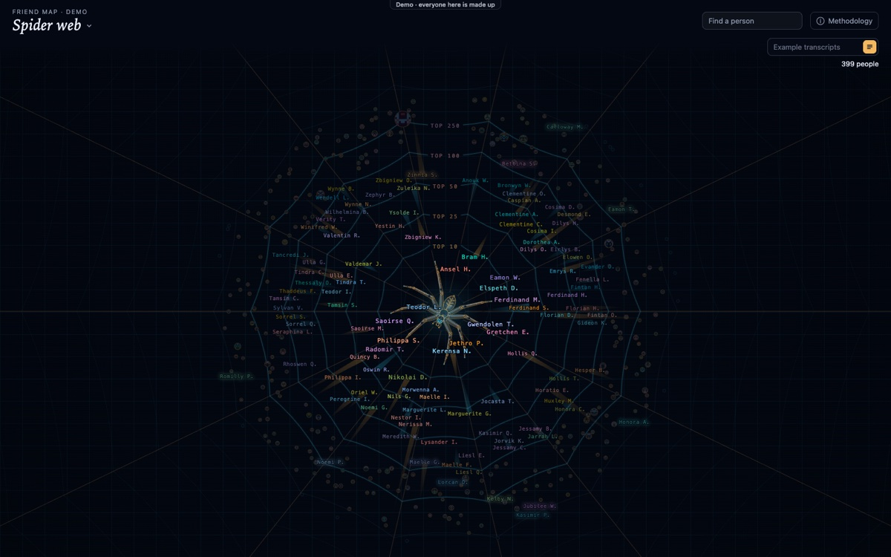

# friend-map

A map of your friendships, drawn from your message history. Everyone you talk to sits closer or further out by how much you talk, call and meet, and how recently.

It opens on the **Spider web**; **Orbits** draws the same map as a 3D solar system, and there are others: a cyberspace city, a table, a calendar and a time river. friend-map is a front end with no database of its own: it draws from any backend that serves its [data contract](docs/contract.md).



**Demo:** there is no public site yet. To see it, build and serve the static demo (below), or open `/demo` in a running app. Everyone in it is made up.

## Quick start

Needs Node 24.21.0, pinned in `package.json` ([details](docs/running.md#starting-it)).

```sh
npm install

# friend-map on the bundled demo backend, a crowd of made-up people
npm run demo-backend                                     # terminal 1, port 4700
FRIEND_MAP_ARCHIVE_URL=http://127.0.0.1:4700 npm start   # terminal 2, then open http://localhost:4600

# the static demo, no backend needed
npm run build:demo && npm run preview:demo               # then open http://localhost:4173

npm test
npm run typecheck
```

## Docs

- [Running friend-map](docs/running.md): starting it, phone access, the data folder, the demo backend, bringing your own backend
- [Settings](docs/settings.md): the settings file, and how closeness is scored
- [The views](docs/views.md): every view, and the Query bar
- [The demo](docs/demo.md): the static demo and publishing it
- [How it is wired](docs/wiring.md): the code, and keeping private data out of commits
- [Data contract](docs/contract.md): build a backend for friend-map; the demo backend is a worked example ([its README](examples/demo-backend/README.md))

## Licence

MIT: see [LICENSE](LICENSE).
